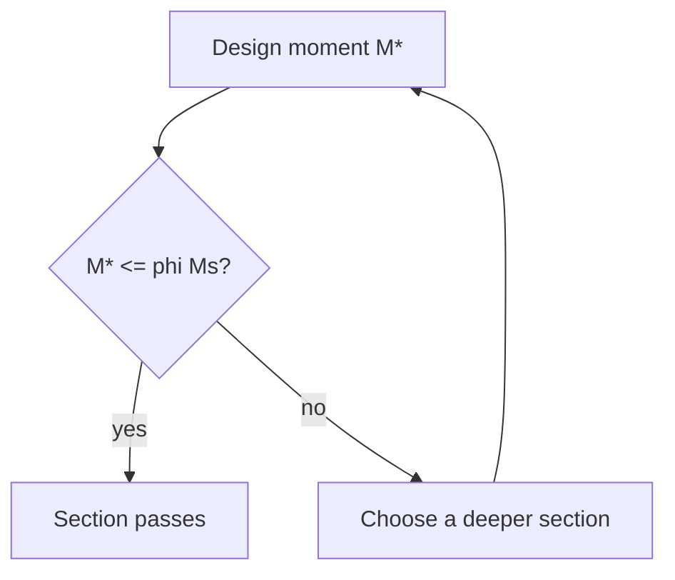
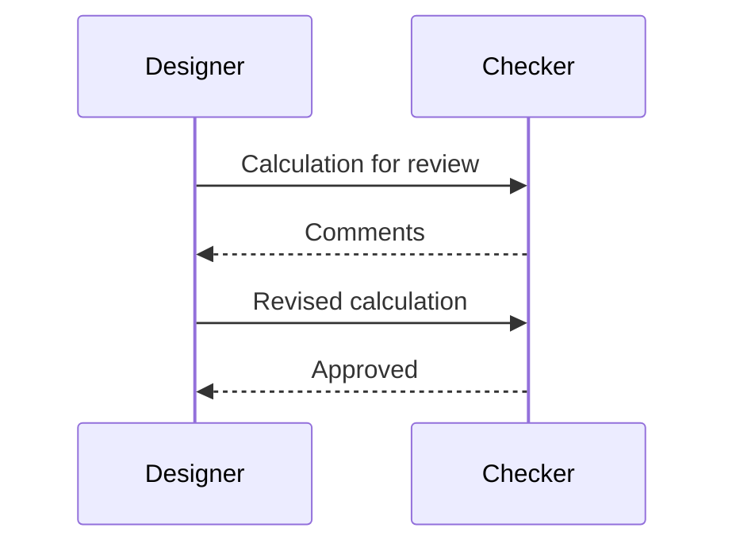
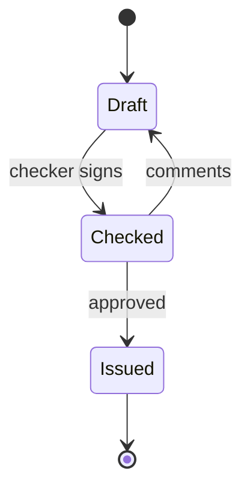

# Diagrams

A diagram is written as text in a fenced block tagged `mermaid`, and the results draw it. Type the
steps, the app draws the boxes and arrows. Edit the text and the drawing follows. The language of
the fence is Mermaid's, and it covers flow charts, sequence diagrams, state diagrams, timelines and
more.

Three small examples follow. Copy one into a sheet to see it drawn.

## A flow chart

`flowchart TD` draws from top to bottom (`LR` draws from left to right). A box is a name and its
label in square brackets, a decision is in braces, and `-->` is an arrow. Text between `--` and
`-->` labels the arrow.

<!-- expect: OK: the section passes. -->
````sheet
# Design check



Mstar: 54 kN*m | design moment
phiMs: 332 kN*m | design capacity
if Mstar <= phiMs: "OK: the section passes." else: "Fails: choose a deeper section."
````

## A sequence diagram

`sequenceDiagram` draws people or parts side by side and the messages between them, in order from
the top. `->>` is a solid arrow and `-->>` a dashed one.

````sheet
# Review of the calculation


````

## A state diagram

`stateDiagram-v2` draws the states something passes through. `[*]` is the start or the end, and the
text after a colon labels the change.

````sheet
# Status of the calculation


````

A timeline (`timeline`, then lines of `period : event`) works the same way.

## Learning more

Every diagram type and option is described in the Mermaid project's own documentation; what it
shows there can be pasted into a fence here. Two samples show diagrams in a whole calculation:
**Design check as a flow diagram** and **Load path and tributary loads** (Resources > Samples).

## Tips

* Keep the text in a box short. A long label wraps onto several lines and makes the box tall.
* A diagram is part of the page, not of the calculation. Names in it are only text: changing `w`
  in a box does not change the load, and a quantity line is still needed for every number.
* In the dark theme a diagram is drawn on a white panel, so it reads the same as on paper.
* A fence that cannot be read shows its text with the reason under it. The usual cause is a
  character the diagram language treats as syntax, such as a bracket or a quote inside a label.

## Printing and exports

Diagrams print and save with the HTML and PDF report as drawings; in Word they appear as their
text. The same fence works inside a `#markdown` block of a Calcpad worksheet. The diagram library
is part of the app and is only loaded when a page has a diagram, so it works offline and costs
nothing on a page without one. The `layout: elk` option of Mermaid is not available; diagrams use
the standard layout.
