# Diagrams

A diagram is written as text in a fenced block tagged `mermaid`, and the results draw it. Type the
steps, the app draws the boxes and arrows. Edit the text and the drawing follows. The language of
the fence is Mermaid's, and the app bundles Mermaid 12.1.0, which draws more than thirty kinds of
diagram and chart: flow charts, sequence and state diagrams, Gantt charts, pie and XY charts,
Sankey diagrams, mind maps and more.

This chapter is a gallery: one small example of each kind, grouped by what it is for. Copy one
into a sheet to see it drawn, then change it. A kind whose first word ends in `-beta` is new in
the diagram library, and its syntax may still change in a later version. The kinds that are not
available are listed [at the end](#kinds-that-are-not-available), and the [samples](#samples)
show diagrams next to the calculations they describe.

## Starting from the ribbon

The **Diagrams** menu in the **Figures** group of the **Plots & Diagrams** tab of the ribbon inserts a short starter
diagram, so there is no syntax to learn before the first one. Put the caret where the diagram
should go and pick a kind: flowchart, sequence, state, block, architecture, entity relationship,
requirement, tree view, mind map, fishbone, Gantt, timeline, pie, XY chart, quadrant, radar,
Sankey or treemap. In a sheet the starter goes in as a block of its own after the paragraph or
block the caret is in; in a Calcpad worksheet it goes in a `#markdown` block after the caret's
line. Its text is left selected, ready to edit, and Undo takes it out in one step. The menu offers
the kinds engineers use most; the other kinds can be typed by hand, and the gallery below shows
them all.

A diagram does not read the sheet's numbers. Work a value out with a quantity line and type it
into the diagram, as the samples do.

## Processes and behaviour

### Flow chart

`flowchart TD` draws from top to bottom (`LR` draws from left to right). A box is a name and its
label in square brackets, a decision is in braces, and `-->` is an arrow. Text between `--` and
`-->` labels the arrow.

<!-- expect: OK: the section passes. -->
````sheet
# Design check

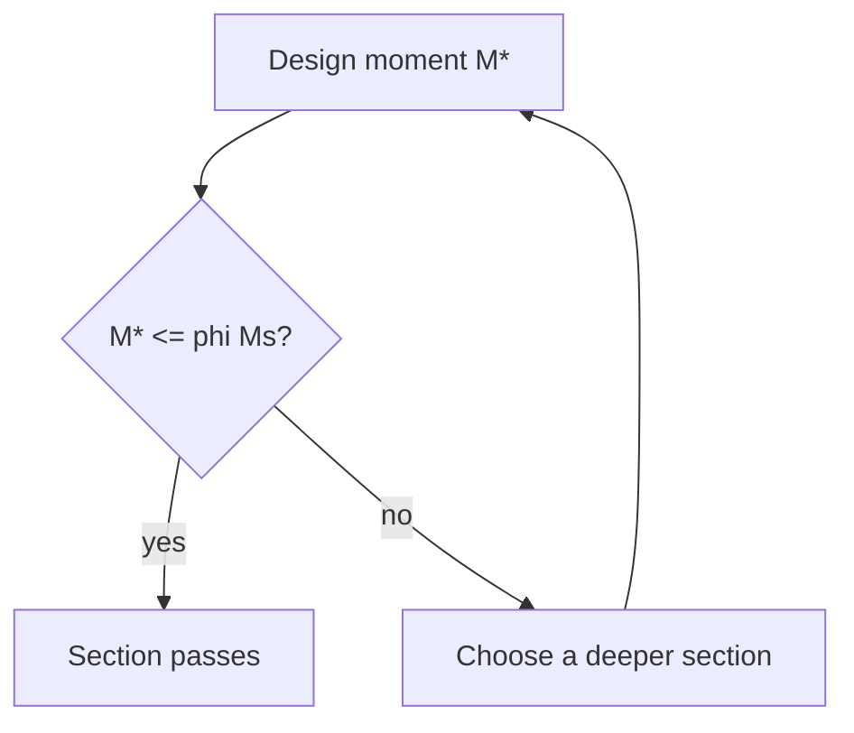

Mstar: 54 kN*m | design moment
phiMs: 332 kN*m | design capacity
if Mstar <= phiMs: "OK: the section passes." else: "Fails: choose a deeper section."
````

### Sequence diagram

`sequenceDiagram` draws people or parts side by side and the messages between them, in order from
the top. `->>` is a solid arrow and `-->>` a dashed one.

````sheet
# Review of the calculation

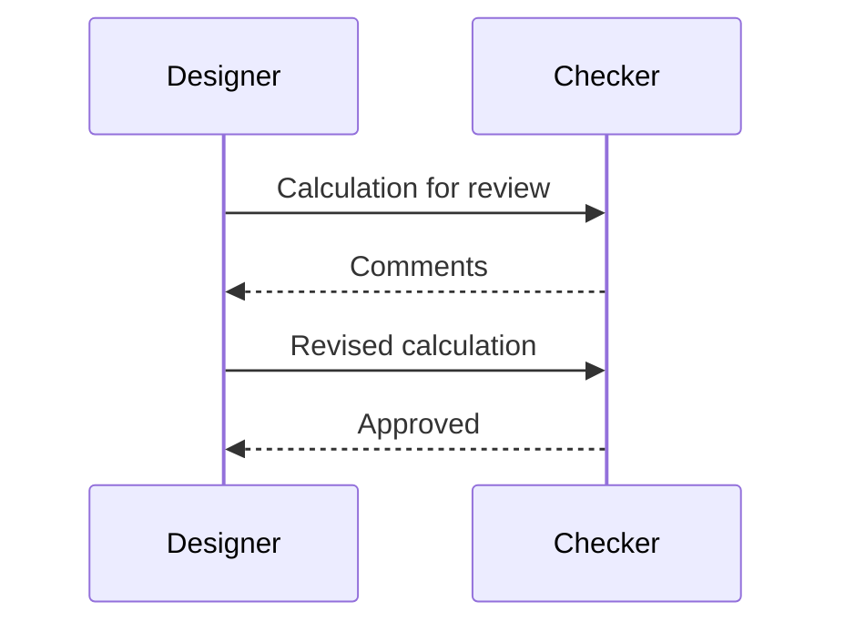
````

### State diagram

`stateDiagram-v2` draws the states something passes through. `[*]` is the start or the end, and the
text after a colon labels the change.

````sheet
# Status of the calculation

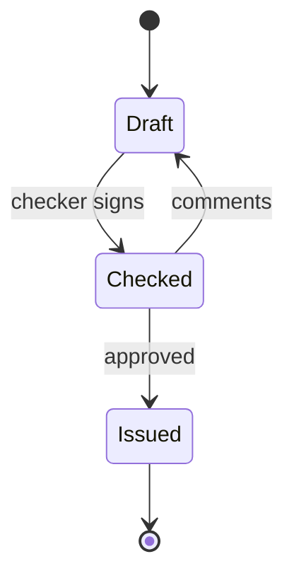
````

### User journey

`journey` scores each step of a task from 1 (bad) to 5 (good) for the people who take part.

````sheet
# Inspection of a slab pour

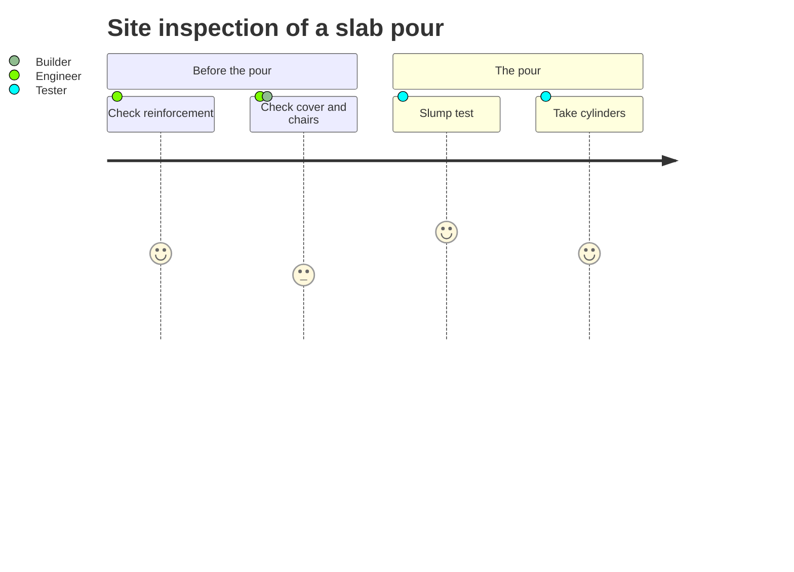
````

### Use case diagram

`usecase-beta` draws actors and the things they do. `actor` names the actors, and
`name(label)` is a use case.

````sheet
# Who does what

```mermaid
usecase-beta
  actor Designer, Checker
  Designer --> design(Design a member)
  Designer --> report(Print the report)
  Checker --> review(Review the calculation)
```
````

### Event model

`eventmodeling` draws a process as frames in time order: `tf` is a time frame with a number, a
kind (`ui`, `cmd`, `evt`, `rmo`) and a name, and `->>` points to the frame it follows.

````sheet
# A check from input to report

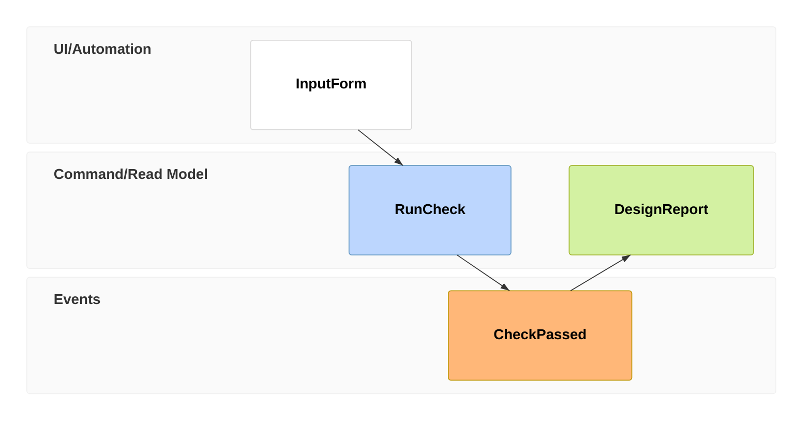
````

## Structure and data

### Class diagram

`classDiagram` draws classes with their fields and methods. `<|--` is inheritance.

````sheet
# Section shapes

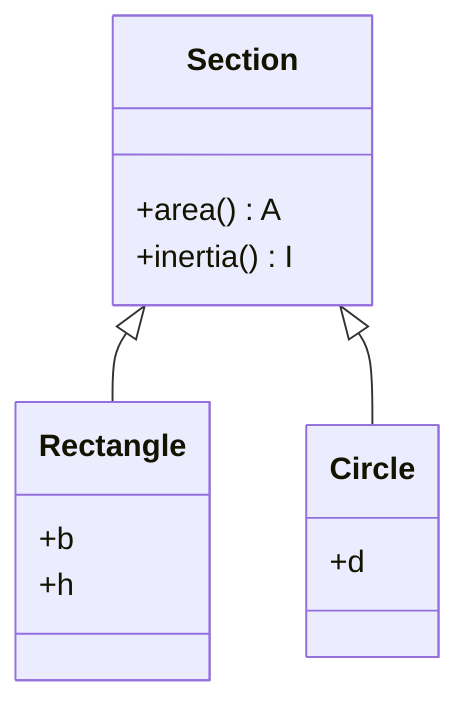
````

### Entity relationship diagram

`erDiagram` draws a data model. `}o--||` reads "many to exactly one", and the braces list the
attributes of an entity.

````sheet
# Member data model

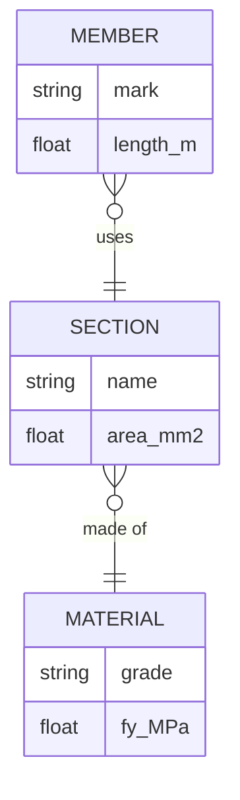
````

### Requirement diagram

`requirementDiagram` ties requirements to the elements that satisfy or verify them.

````sheet
# Traceability

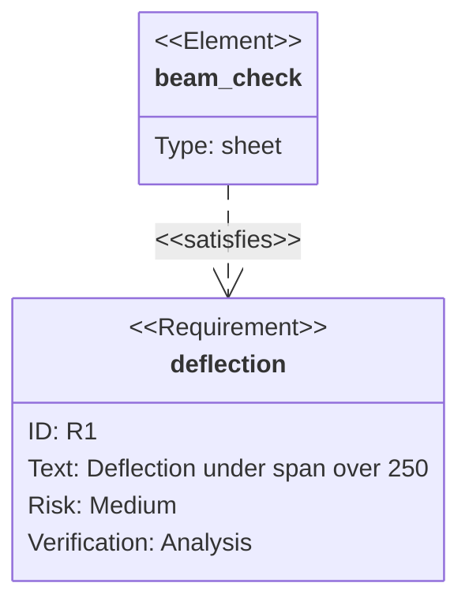
````

### Block diagram

`block-beta` lays blocks out on a grid. `columns 3` sets the grid, `:3` makes a block span three
columns and `space` leaves a gap.

````sheet
# A portal frame in blocks

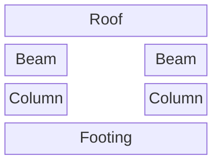
````

### Architecture diagram

`architecture-beta` draws services with icons (`cloud`, `database`, `disk`, `internet`, `server`)
in groups. `sensors:R -- L:logger` joins the right side of one to the left side of the other.

````sheet
# Monitoring a bridge

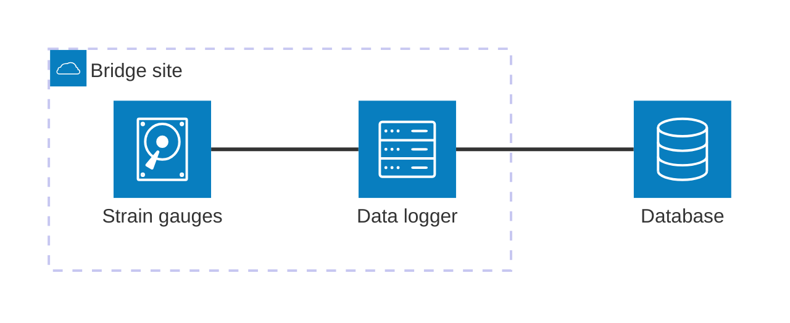
````

### C4 diagram

`C4Context` draws a system in its setting, in the C4 model's notation: people, systems and the
relations between them.

````sheet
# Context of a calculation system

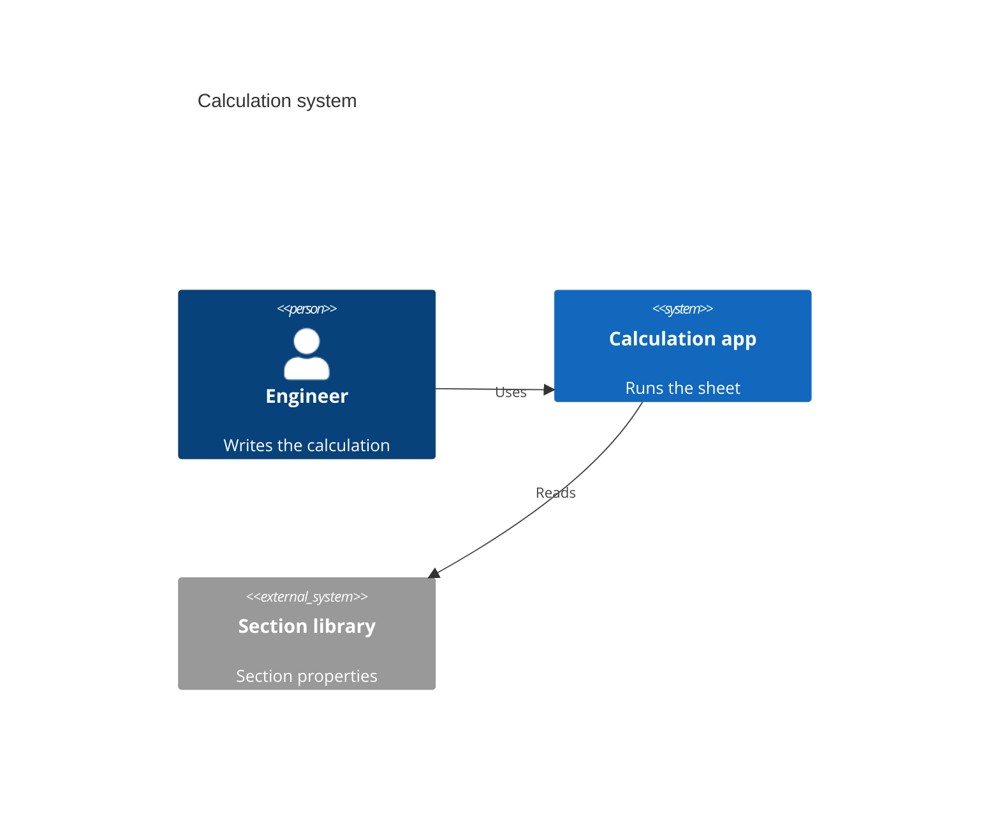
````

### Packet diagram

`packet-beta` draws the fields of a data record by bit position.

````sheet
# A logger record

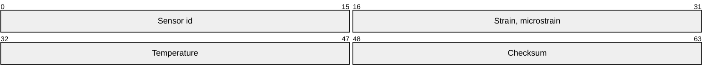
````

## Plans and time

### Gantt chart

`gantt` draws tasks against dates. `dateFormat` sets how dates are written, `after a1` starts a
task when another ends, and a duration such as `10d` is in days.

````sheet
# Design programme

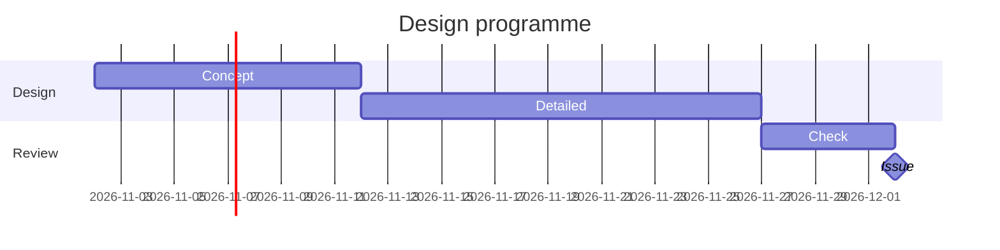
````

### Timeline

`timeline` lists events by period, one line each: `period : event`.

````sheet
# Strength gain

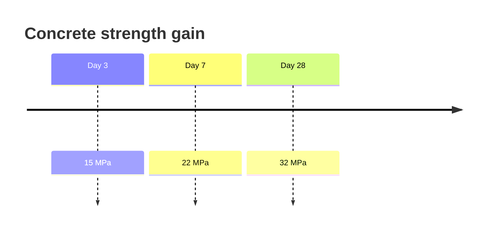
````

### Kanban board

`kanban` draws columns of cards. A line indented under a column is a card in it.

````sheet
# Design tasks

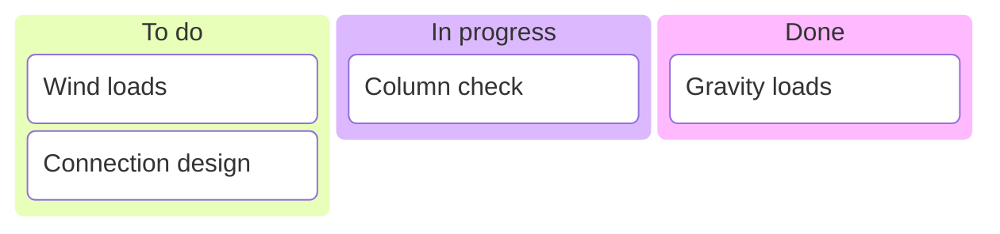
````

### Git graph

`gitGraph` draws commits on branches, here the revisions of a calculation and a checker's branch.

````sheet
# Revisions

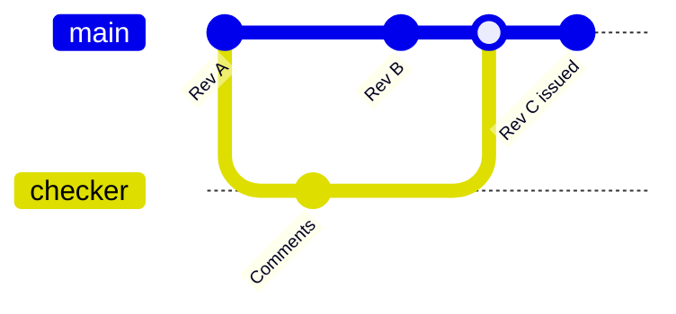
````

## Charts of numbers

### Pie chart

`pie` draws each value as a slice; `showData` adds the values to the legend.

````sheet
# Dead load share

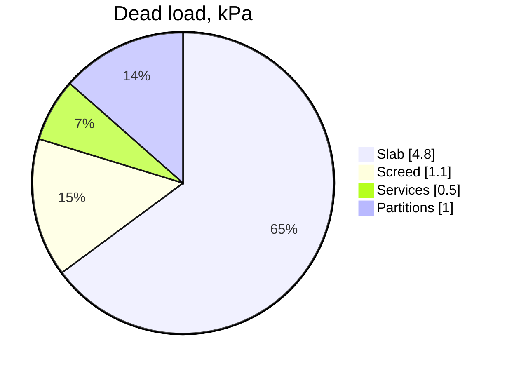
````

### XY chart

`xychart-beta` draws bars and lines over an x axis of categories or numbers.

````sheet
# Moment along a beam

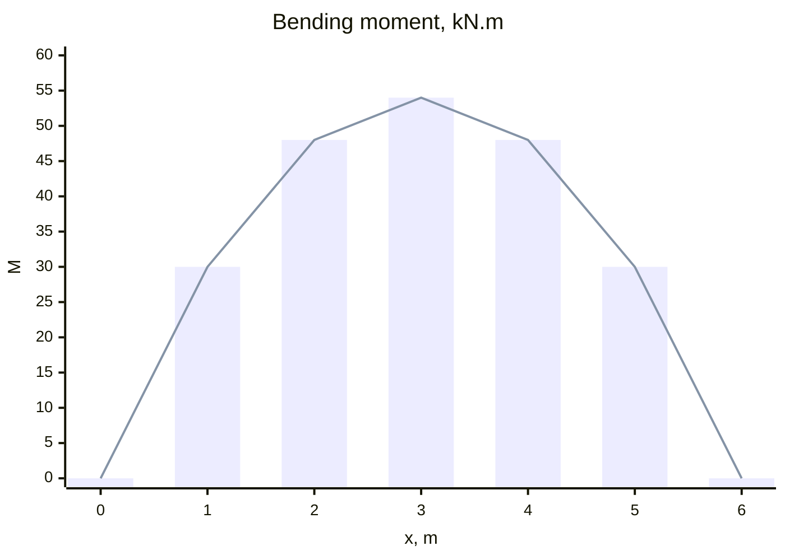
````

### Quadrant chart

`quadrantChart` places points with coordinates from 0 to 1 in four labelled quadrants.

````sheet
# Risk matrix

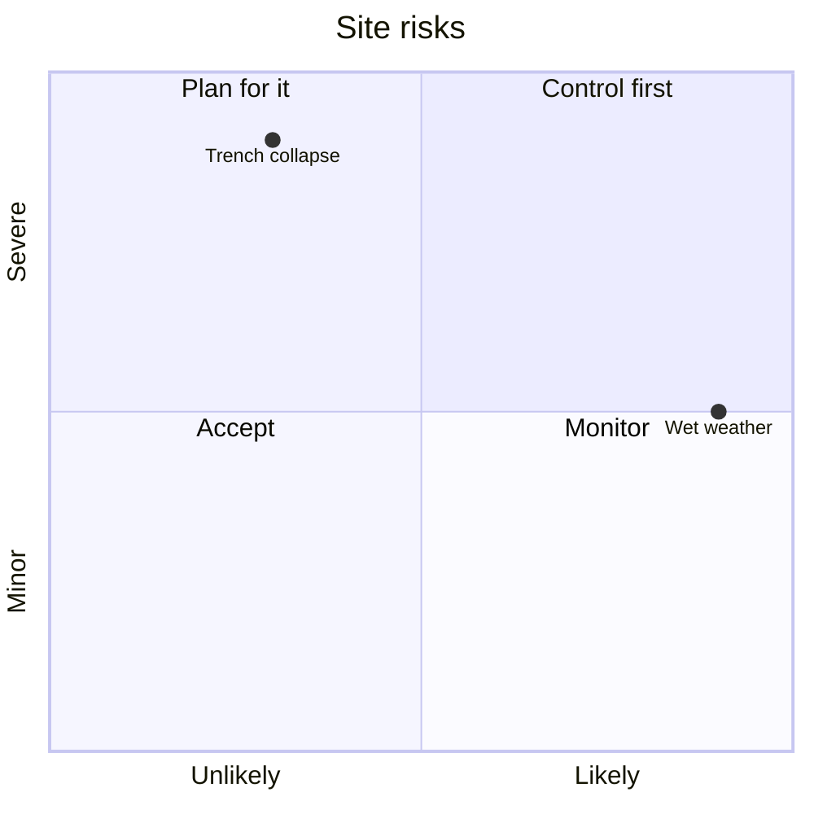
````

### Radar chart

`radar-beta` compares options over several axes. `max` sets the outer ring.

````sheet
# Floor systems

```mermaid
radar-beta
  title Floor systems
  axis cost["Cost"], speed["Speed"], depth["Shallow depth"], span["Span"]
  curve flat["Flat plate"]{4, 3, 5, 2}
  curve steel["Steel and deck"]{3, 5, 3, 4}
  max 5
```
````

### Sankey diagram

`sankey-beta` draws flows as bands whose width is the value. Each line is `from,to,value`.

````sheet
# Energy through a pump

```mermaid
sankey-beta
Input,Motor,43.3
Motor,Motor losses,3.0
Motor,Pump,40.3
Pump,Pump losses,8.9
Pump,Water,31.4
```
````

### Treemap

`treemap` draws nested rectangles with an area in proportion to the value. Indentation nests an
item in its group.

````sheet
# Cost plan

```mermaid
treemap
"Cost plan"
    "Structure"
        "Frame": 310
        "Floors": 260
    "Envelope"
        "Facade": 280
        "Roof": 90
```
````

## Ideas and analysis

### Mind map

`mindmap` draws a tree from its root; indentation gives the branches. `((text))` draws a circle.

````sheet
# Footbridge brief

```mermaid
mindmap
  root((Footbridge))
    Geometry
      Span 24 m
      Width 2.5 m
    Loads
      Crowd 5 kPa
    Limits
      Deflection L/360
```
````

### Ishikawa (fishbone) diagram

`ishikawa-beta` draws an effect at the head and its causes on the bones. Indentation gives the
categories and the causes in each.

````sheet
# Causes of cracking

```mermaid
ishikawa-beta
  Cracked slab
    Materials
      High water content
    Method
      Late curing
    Design
      Joints too far apart
```
````

### Venn diagram

`venn-beta` draws sets as circles. `set` adds a set, and `union` labels where sets overlap.

````sheet
# Kinds of check

```mermaid
venn-beta
  title Checks
  set S["Strength"]
  set V["Serviceability"]
  union S, V["Both"]
```
````

### Cynefin framework

`cynefin-beta` places items in the five domains (`complex`, `complicated`, `clear`, `chaotic`,
`confusion`). An item is a quoted text, and `-->` shows a move from one domain to another.

````sheet
# Kinds of design problem

```mermaid
cynefin-beta
  complex
    "Novel bracing system"
  complicated
    "Long-span roof"
  clear
    "Standard lintel"
  chaotic
    "Collapse on site"
  chaotic --> complex : "Make safe, then probe"
```
````

### Wardley map

`wardley-beta` maps components by visibility (up) and evolution (across). The coordinates are
`[visibility, evolution]`, from 0 to 1, and `->` joins a component to one it depends on.

````sheet
# Design office

```mermaid
wardley-beta
  title Design office
  anchor Client [0.95, 0.6]
  component Calculation [0.7, 0.5]
  component Section tables [0.4, 0.85]
  Client -> Calculation
  Calculation -> Section tables
```
````

### Tree view

`treeView-beta` draws an indented list as a tree, such as the folders of a project.

````sheet
# Project folders

```mermaid
treeView-beta
  project
    calcs
      beams.sheet
      columns.sheet
    drawings
      general.pdf
```
````

## Grammars: railroad diagrams

A railroad diagram draws the grammar of a language: follow the track from left to right. Each
rule ends with `;`. The same drawing comes from four notations.

### EBNF

`railroad-ebnf-beta`: `,` joins in sequence and `[ ]` is optional. This is the grammar of a
quantity line.

````sheet
# A quantity line

```mermaid
railroad-ebnf-beta
  quantity = name , ":" , expression , [ "->" , unit ] , [ "|" , note ] ;
```
````

### ABNF

`railroad-abnf-beta`: `1*DIGIT` is one or more digits and `[ ]` is optional.

````sheet
# A number

```mermaid
railroad-abnf-beta
  number = 1*DIGIT [ "." 1*DIGIT ] ;
```
````

### PEG

`railroad-peg-beta`: `<-` defines a rule, `+` is one or more and `?` is optional.

````sheet
# A number

```mermaid
railroad-peg-beta
  Number <- Digit+ ("." Digit+)? ;
```
````

### Railroad functions

`railroad-beta` builds a diagram from functions: `sequence`, `choice`, `optional`, `oneOrMore`,
`zeroOrMore`, `terminal` and `nonterminal`.

````sheet
# A quantity line

```mermaid
railroad-beta
  quantity = sequence(nonterminal("name"), terminal(":"), nonterminal("expression"), optional(sequence(terminal("|"), nonterminal("note")))) ;
```
````

## Kinds that are not available

Every kind above was drawn in the app with the bundled Mermaid 12.1.0. These are not available:

| Kind | Why |
| --- | --- |
| ZenUML (`zenuml`) | A separate plugin of the diagram library, not part of the app. The fence shows "No diagram type detected". Use a sequence diagram instead. |
| The `elk` layout (`layout: elk`) | Not shipped; diagrams use the standard layout. |

## Samples

The **Plots and diagrams** group of the Samples dialog (Resources > Samples) has sheets with a
diagram next to the calculation it describes:

* **Design check as a flow diagram** and **Load path and tributary loads** (flow charts)
* **Design states of a steel beam** (state diagram) and **Review and sign-off** (sequence diagram)
* **Construction programme** (Gantt chart), with durations worked out from quantities and rates
* **Dead load share** (pie chart) and **Cost plan** (treemap), with the shares worked out
* **Site risk matrix** (quadrant chart) and **Bending moment along a beam** (XY chart)
* **Energy flow through a pump** (Sankey), from the hydraulic power back to the electrical input
* **Footbridge design brief** (mind map) and **Requirements traceability** (requirement diagram)
* **Concrete strength gain** (timeline) and **Section shapes** (class diagram)

For plots drawn from a function, see [Plots](../plots.md).

## Learning more

Every diagram type and option is described in the Mermaid project's own documentation; what it
shows there can be pasted into a fence here, as long as the kind is in the gallery above.

## Tips

* Keep the text in a box short. A long label wraps onto several lines and makes the box tall.
* A diagram is part of the page, not of the calculation. Names in it are only text: changing `w`
  in a box does not change the load, and a quantity line is still needed for every number.
* In the dark theme a diagram is drawn on a white panel, so it reads the same as on paper.
* A fence that cannot be read shows its text with the reason under it. The usual cause is a
  character the diagram language treats as syntax, such as a bracket or a quote inside a label.

## Printing and exports

Diagrams print and save with the HTML and PDF report as drawings; in Word they appear as their
text. The same fence works inside a `#markdown` block of a Calcpad worksheet. The diagram library
is part of the app and is only loaded when a page has a diagram, so it works offline and costs
nothing on a page without one.
